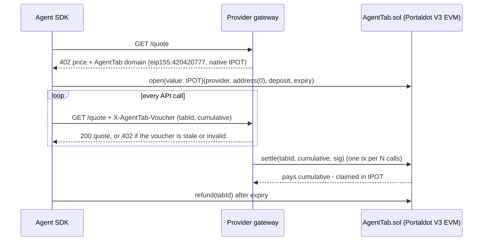
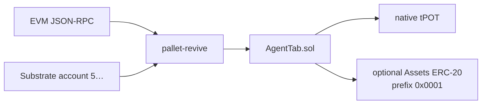

# AgentTab on Portaldot V3 — pay-per-call payment tabs for AI agents

AI agents can't manage subscriptions or API keys, but they can pay. **AgentTab** lets an agent escrow
native **tPOTv3/POT** (or any ERC-20 on Portaldot) for an API provider once, then sign an **EIP-712 voucher**
with the new cumulative amount on every call. The provider batch-settles many calls in one transaction,
and the agent reclaims the unspent balance after expiry. It runs as a Solidity contract on Portaldot V3's
EVM-compatible execution layer (pallet-revive).

The provider in this repo sells calls over **HTTP 402**. The only rail in the challenge is AgentTab on
chain `420420777`. There is no x402 facilitator and no stablecoin asset — see [Reuse disclosure](#reuse-disclosure).

## Product architecture



Component notes, the 14-decimal / 18-decimal split, and the voucher checks: [`docs/ARCHITECTURE.md`](docs/ARCHITECTURE.md).

The same bytecode is also reachable from a native Substrate account. `ReviveApi_call` is the dry-run; `Revive.call` (pallet 80, call 1) is the extrinsic. No second contract.



## Status (2026-10-22)
- Contract ported and tested: `forge test` → 7 passing (ERC-20 tabs, native tabs, bad sig, stale, exceeds, refund, top-up).
- **Deployed on Portaldot V3 testnet** (chain `420420777`):
  - AgentTab: `0x9a096C216f79e08C2DB95d92F412697D8F1f9329`
  - Deploy tx: `0xe8a4376602a5467574dd7f2e966006da4fe41275d28a989e33f116fa57baab72`
  - Demo open: `0xc27ab271b49103a257046c7458805ed1c73988d464f61aa98bfe6338a13e534e`
  - Demo settle: `0xd58678d04863861cda814284eb2879d0abcaf85ca64779cc5e69f2a670b8ac5b` (native tPOT tab #1)
- **Provider gateway + TypeScript SDK** (`gateway/`, `sdk/`): unpaid `GET /quote` returns 402; a signed voucher is verified locally. `npm test` and `npm run dry-run` need no RPC and no key. **Live testnet demo 2026-10-23:** open tab #2 `0x9922d9a7…`, settle `0x2031c40d…` (see `DEPLOYMENT.md`).
- **Substrate path** (`substrate/`): `ReviveApi_call` from the deployer's public fallback account `5Fe78…` reads `remaining(1) == 5e15`, matching `eth_call`. A `settle` dry-run reverts `NotProvider`. Unsigned `Revive.call` bytes are in `runs/revive-probe.json`. No Substrate extrinsic was submitted.
- **Dashboard** ([`dashboard/`](dashboard/)): static tab inspector. `npm run dashboard` serves it with no key. Remaining, provider, and expiry come from the public RPC.
- Full addresses, hashes, and explorer notes: [`DEPLOYMENT.md`](DEPLOYMENT.md) / [`deployments/portaldot-testnet.json`](deployments/portaldot-testnet.json).
- DoraHacks check-in copy-paste (中文 + English): [`CHECKIN.md`](CHECKIN.md).

## Network
| | |
|---|---|
| EVM RPC | `https://test-evm-rpc-v3.portaldot.dev` (chain ID `420420777`) |
| Substrate RPC | `wss://test-node-v3.portaldot.dev` (chain "PortaldotV3 Test", SS58 42) |
| Token | `tPOTv3`, 14 decimals on Substrate, 18-decimal wei on the EVM RPC (`1 planck = 10_000 wei`) |
| Explorer | https://node-console.portaldot.dev |
| AgentTab | `0x9a096C216f79e08C2DB95d92F412697D8F1f9329` |
| Deployer | `0x9e2e2024c7dcA86e57608e2ceAD160081c381fDd` |

## Run the gateway (no key, no RPC)

```bash
npm install
npm test          # 402 challenge, voucher accept/reject, open calldata
npm run dry-run   # binds a local port, prints 402 then one paid call
npm run gateway   # GET http://127.0.0.1:8402/quote → 402
```

`npm run gateway` defaults to `CHAIN_MODE=memory`. It answers the 402 from the deployed contract's domain and does not submit transactions. The paid path in CI uses an in-memory tab (`gateway/test`, `npm run dry-run`).

Unpaid response (truncated):

```json
{
  "error": "payment_required",
  "rail": "agenttab",
  "price": { "amountWei": "100000000000000", "amountTpot": "0.0001", "symbol": "tPOT", "substrateDecimals": 14, "evmDecimals": 18 },
  "accept": { "scheme": "agenttab", "network": "eip155:420420777", "chainId": 420420777, "token": "0x0000000000000000000000000000000000000000" }
}
```

## Dashboard (no key)

[`dashboard/`](dashboard/) is a static inspector. It calls `tabs`, `remaining`, `nextId`, and `Opened` / `Settled` logs on the public EVM RPC from the browser. If the RPC is quiet, the page stays empty instead of filling in a balance. Open and settle hashes link to the [node console](https://node-console.portaldot.dev) (paste the hash under Network → events; that site has no per-transaction route). The same page shows the local `GET /quote` 402 flow and can probe `http://127.0.0.1:8402/quote` when the gateway is running.

```bash
npm run dashboard
# http://127.0.0.1:4173
```

The folder has no build step and no secret, so it can be published as GitHub Pages (serve the `dashboard/` directory) or opened from that local command. `npm run gateway` sends `Access-Control-Allow-Origin: *` on `GET /quote`, which is what lets the page read a loopback gateway.

## Run against Portaldot V3 testnet

Use a throwaway key. Put it in `.env` (gitignored) or the environment. Never commit it.
Fund the **mapped SS58 account** (node console → Developer → Runtime calls → reviveApi → accountId). The H160 is not the account that holds tPOT.

```bash
cp .env.example .env
# AGENT_PK, PROVIDER_ADDRESS, optional PROVIDER_PK

# 1. Payer escrows native tPOT (legacy tx, gas = eth_estimateGas)
CHAIN_MODE=rpc AGENT_PK=0x... PROVIDER_ADDRESS=0x... DEPOSIT_TPOT=0.01 npm run open-tab

# 2. Provider verifies vouchers against the live tab and settles every SETTLE_EVERY calls
CHAIN_MODE=rpc PROVIDER_ADDRESS=0x... PROVIDER_PK=0x... npm run gateway

# 3. Payer buys one call (reads claimed via RPC, signs cumulative = claimed + price)
API_BASE=http://127.0.0.1:8402 TAB_ID=1 AGENT_PK=0x... npm run call
```

`open` / `topUp` / `settle` go out as legacy transactions. pallet-revive's `eth_estimateGas` is much larger than an Ethereum gas limit; the SDK passes that estimate through, same as [`scripts/deploy.sh`](scripts/deploy.sh).

Substrate dry-run (no key, reads the public testnet, writes `runs/revive-probe.json`):

```bash
npm run revive-probe
```

Contract-only deploy (no gateway):

```bash
forge test
cp .env.example .env   # throwaway testnet key only; set DEPLOYER_ADDRESS too
scripts/deploy.sh      # refuses to run if unfunded; uses legacy + estimateGas gas-limit
```

### SDK sketch

```ts
import { createPublicClient, createWalletClient, http } from "viem";
import { privateKeyToAccount } from "viem/accounts";
import {
  openNativeTab, parseTpot, portaldotV3Testnet, signVoucher, tabIdFromReceipt,
} from "agenttab-portaldot-sdk";

const account = privateKeyToAccount(process.env.AGENT_PK as `0x${string}`);
const transport = http("https://test-evm-rpc-v3.portaldot.dev");
const publicClient = createPublicClient({ chain: portaldotV3Testnet, transport });
const walletClient = createWalletClient({ account, chain: portaldotV3Testnet, transport });

const hash = await openNativeTab(
  { account, publicClient, walletClient },
  { provider: "0x…", depositWei: parseTpot("0.01"), expiry: BigInt(Math.floor(Date.now() / 1000) + 86400) },
);
const tabId = tabIdFromReceipt(await publicClient.waitForTransactionReceipt({ hash }));
const signature = await signVoucher(account, { tabId, cumulative: parseTpot("0.0001") });
```

## Reuse disclosure

`src/AgentTab.sol` is a port of the author's MIT AgentTab contract, written 2026-10-15 for the Celo entry
([agenttab-celo](https://github.com/zwang1111/agenttab-celo)). That repo also sells calls through Celo's x402
facilitator (EIP-3009 USA₮). **This repository does not ship that rail.** `@x402/*`, the facilitator, USA₮
asset config, and ERC-8021 attribution tags are Celo-specific and are not dependencies here.

Portaldot-only code, written for this Hacker House:

- native tPOT tabs in the contract port (`token = address(0)`, payable `open` / `topUp`, `call{value:}` payouts, reentrancy guard)
- `sdk/` — chain `420420777`, 14-decimal planck ↔ 18-decimal wei helpers, EIP-712 sign/verify, legacy gas for pallet-revive
- `gateway/` — HTTP 402 whose body names the AgentTab rail and the deployed testnet contract
- `substrate/` — `ReviveApi_call` / `Revive.call` from an `AccountId32`, and `buildOpenErc20Tab` for the Assets precompile at prefix `0x0001`
- `dashboard/` — static read of the deployed tab via the public RPC, plus the local 402 probe

Dependencies: forge-std (MIT/Apache-2.0), viem (MIT), hono (MIT). The TypeScript packages are MIT. Built with AI assistance (coding agent).
