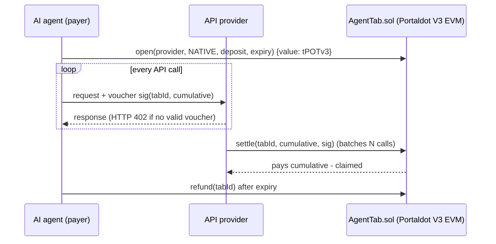

# AgentTab on Portaldot V3 — pay-per-call payment tabs for AI agents

AI agents can't manage subscriptions or API keys, but they can pay. **AgentTab** lets an agent escrow
native **tPOTv3/POT** (or any ERC-20 on Portaldot) for an API provider once, then sign an **EIP-712 voucher**
with the new cumulative amount on every call. The provider batch-settles many calls in one transaction,
and the agent reclaims the unspent balance after expiry. It runs as a Solidity contract on Portaldot V3's
EVM-compatible execution layer (pallet-revive).

## Product architecture



## Status (2026-10-22)
- Contract ported and tested: `forge test` → 7 passing (ERC-20 tabs, native tabs, bad sig, stale, exceeds, refund, top-up).
- **Deployed on Portaldot V3 testnet** (chain `420420777`):
  - AgentTab: `0x9a096C216f79e08C2DB95d92F412697D8F1f9329`
  - Deploy tx: `0xe8a4376602a5467574dd7f2e966006da4fe41275d28a989e33f116fa57baab72`
  - Demo open: `0xc27ab271b49103a257046c7458805ed1c73988d464f61aa98bfe6338a13e534e`
  - Demo settle: `0xd58678d04863861cda814284eb2879d0abcaf85ca64779cc5e69f2a670b8ac5b` (native tPOT tab #1)
- Full addresses, hashes, and explorer notes: [`DEPLOYMENT.md`](DEPLOYMENT.md) / [`deployments/portaldot-testnet.json`](deployments/portaldot-testnet.json).
- DoraHacks check-in copy-paste (中文 + English): [`CHECKIN.md`](CHECKIN.md).

## Network
| | |
|---|---|
| EVM RPC | `https://test-evm-rpc-v3.portaldot.dev` (chain ID `420420777`) |
| Substrate RPC | `wss://test-node-v3.portaldot.dev` (chain "PortaldotV3 Test", SS58 42) |
| Token | `tPOTv3`, 14 decimals on the Substrate side |
| Explorer | https://node-console.portaldot.dev |
| Deployer | `0x9e2e2024c7dcA86e57608e2ceAD160081c381fDd` |

## Run
```bash
forge test
cp .env.example .env   # throwaway testnet key only; set DEPLOYER_ADDRESS too
scripts/deploy.sh      # refuses to run if unfunded; uses legacy + estimateGas gas-limit
```

## Origin and disclosure
Ported from AgentTab (MIT), the author's x402/channel contract built 2026-10-15 for Celo. The Portaldot port adds native-token
tabs, `call{value:}` payouts, a reentrancy guard and tab-existence checks. Built with AI assistance (coding agent). Dependencies: forge-std.
