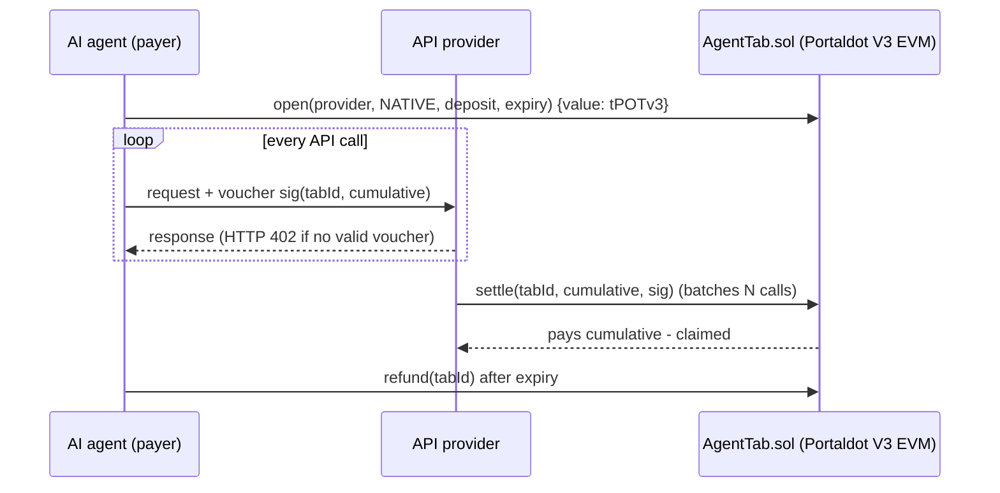

# AgentTab on Portaldot V3 — pay-per-call payment tabs for AI agents

AI agents can't manage subscriptions or API keys, but they can pay. **AgentTab** lets an agent escrow
native **tPOTv3/POT** (or any ERC-20 on Portaldot) for an API provider once, then sign an **EIP-712 voucher**
with the new cumulative amount on every call. The provider batch-settles many calls in one transaction,
and the agent reclaims the unspent balance after expiry. It runs as a Solidity contract on Portaldot V3's
EVM-compatible execution layer (pallet-revive).



## Status (2026-10-17)
- Contract ported and tested: `forge test` → 7 passing (ERC-20 tabs, native tabs, bad sig, stale, exceeds, refund, top-up).
- **Live testnet dry run:** `eth_call` deploy of AgentTab against the Portaldot V3 testnet returns the full runtime code, so the
  EVM bytecode is accepted as is (`runs/dryrun-*.log`).
- **Not yet deployed:** the deployer is unfunded. Testnet tokens are distributed to registered participants; see `PLAN.md`.

## Network
| | |
|---|---|
| EVM RPC | `https://test-evm-rpc-v3.portaldot.dev` (chain ID `420420777`) |
| Substrate RPC | `wss://test-node-v3.portaldot.dev` (chain "PortaldotV3 Test", SS58 42) |
| Token | `tPOTv3`, 14 decimals on the Substrate side |
| Explorer | https://node-console.portaldot.dev |

## Run
```bash
forge test
cp .env.example .env   # throwaway testnet key only
scripts/deploy.sh      # refuses to run if unfunded
```

## Origin and disclosure
Ported from AgentTab (MIT), the author's x402/channel contract built 2026-10-15 for Celo. The Portaldot port adds native-token
tabs, `call{value:}` payouts, a reentrancy guard and tab-existence checks. Built with AI assistance (coding agent). Dependencies: forge-std.
