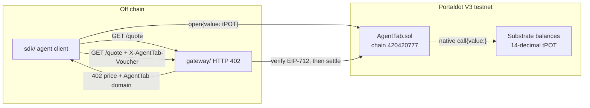

# Architecture — AgentTab on Portaldot V3

Pay-per-call middleware for an API provider and an AI agent. The agent escrows native **tPOTv3** once. Each HTTP call carries an EIP-712 voucher. The provider batch-settles on Portaldot V3's EVM (pallet-revive).

This is the Portaldot path. It does not use the Celo sibling's x402 facilitator, USA₮, or EIP-3009 rail. Those services are not on this chain.

## Components



| Piece | Role |
|---|---|
| `src/AgentTab.sol` | Escrow. Native tabs use `token = address(0)` and payable `open` / `topUp`. `settle` pays the provider the delta of a cumulative voucher. `refund` returns the rest after expiry. |
| `sdk/` | Chain config, tPOT unit helpers, voucher sign/verify, and the legacy-gas writers used against pallet-revive. |
| `gateway/` | Provider process. Unpaid `GET /quote` is **402**. A valid `X-AgentTab-Voucher` is **200** and, every N calls, one `settle`. |

## HTTP 402 body

`GET /quote` with no voucher responds `402` and `X-AgentTab-Required`. The JSON body is the whole offer:

- `price.amountWei` — EVM `uint256` the voucher must cover (18-decimal wei).
- `price.amountTpot` / `price.amountPlanck` — the same price in human tPOT and in Substrate planck.
- `accept.scheme = "agenttab"`, `accept.network = "eip155:420420777"`.
- `accept.contract` — AgentTab (`0x9a096C216f79e08C2DB95d92F412697D8F1f9329` on testnet).
- `accept.payTo` — the provider who may call `settle`.
- `accept.voucher` — EIP-712 domain `AgentTab` / `1` / chain id / contract, type `Voucher(uint256 tabId,uint256 cumulative)`.
- `accept.open` — payable `open(payTo, address(0), depositWei, expiry)` with `msg.value = depositWei`.

The paid request repeats `GET /quote` with:

```
X-AgentTab-Voucher: {"tabId":"1","cumulative":"100000000000000","signature":"0x…"}
```

The header may also be that JSON encoded as base64url. The gateway accepts the call only when all of the following hold:

1. `tabs(tabId)` exists and `provider` is this gateway.
2. The tab token is native tPOT (`address(0)`). ERC-20 tabs stay on the contract but are not this gateway's price.
3. `cumulative` is strictly above the last accepted amount (and above on-chain `claimed`), the delta is at least the price, and `cumulative` does not exceed `deposit`.
4. `block` time is before `expiry`.
5. `ecrecover` of the EIP-712 digest equals `payer`.

A voucher is cumulative: the second call signs a larger total, not a fresh per-call amount. Replaying the same signature is `402` with `error: "stale"`. The provider calls `settle(tabId, cumulative, sig)` every `SETTLE_EVERY` accepted calls (default 5), so N HTTP calls become one transaction.

## tPOT: 14 decimals on Substrate, 18 on the EVM RPC

| Layer | Unit | 1 tPOT |
|---|---|---|
| Substrate balances, `Revive.call` `value` | planck | 10^14 |
| EVM `msg.value`, AgentTab `deposit` / `claimed`, MetaMask | wei | 10^18 |
| Conversion | wei per planck | 10^4 |

The deployer balance on `https://test-evm-rpc-v3.portaldot.dev` matches the recorded ~167 tPOT only when the hex balance is divided by 10^18. `sdk` therefore treats AgentTab amounts as wei and converts at the Substrate boundary:

```ts
import { parseTpot, planckToWei, weiToPlanck } from "agenttab-portaldot-sdk";

parseTpot("0.01");            // 10^16 wei — the check-in demo deposit
weiToPlanck(parseTpot("1"));  // 10^14 planck
planckToWei(10n ** 14n);      // 10^18 wei
```

`open{value:}` amounts must be a multiple of 10_000 wei. Anything smaller is not an integer planck, and `buildOpenNativeTab` rejects it.

## Opening a tab, then paying

1. Fund the **mapped SS58 account** (Developer → reviveApi → accountId in the node console). The H160 from the same key is not the Substrate account that holds tPOT.
2. `openNativeTab` sends a **legacy** transaction whose gas limit is `eth_estimateGas`. pallet-revive packs weight and storage deposit into that estimate; a default EVM gas limit is rejected.
3. Read `Opened.id` from the receipt (`tabIdFromReceipt`).
4. For each call, sign `cumulative = previous + price` and send `X-AgentTab-Voucher`.
5. The gateway verifies off chain. It settles on chain every N calls, or whenever the provider submits `settleVoucher`.

`CHAIN_MODE=memory` (the default) never touches the RPC. Use it for the 402 dry-run. `CHAIN_MODE=rpc` reads `tabs(id)` from testnet and, when `PROVIDER_PK` is set, submits `settle`.

## What was reused

`src/AgentTab.sol` is a port of the author's MIT AgentTab contract (Celo, October 2026, <https://github.com/zwang1111/agenttab-celo>). The port adds native tabs, `call{value:}` payouts, a reentrancy guard, and existence checks.

The Celo repository's `agent/` process sells the same quote API on **two** rails and depends on `@x402/*` plus a facilitator. None of that code is imported here. `gateway/` and `sdk/` are new and speak only the AgentTab voucher rail, with Portaldot chain id `420420777` and the tPOT decimal split above.

Third-party libraries: forge-std (MIT/Apache-2.0), viem (MIT), hono (MIT). This TypeScript is MIT.
